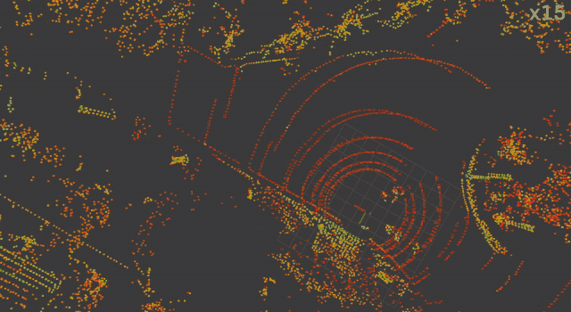
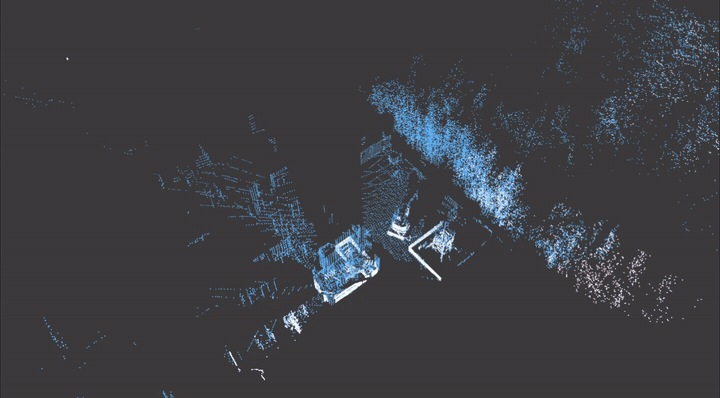
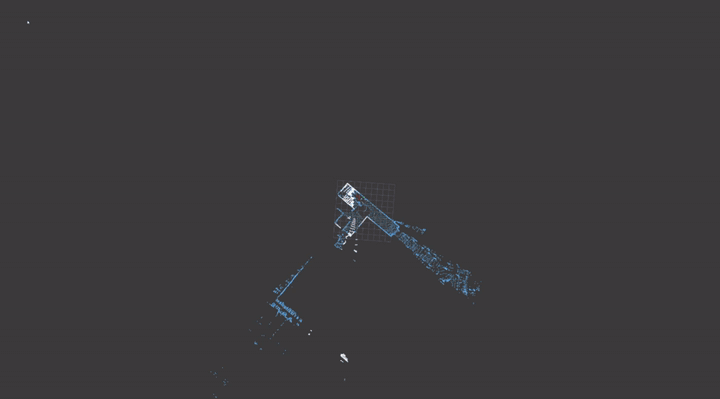

# Sapphire

LiDAR-inertial odometry. Deskew and IMU propagation use the same Gal(3) preintegration. The library is C++17 and has no ROS dependency.

[中文说明](README.zh.md)

## Method B

Load `cfg/cfg_b/nclt.toml` and pass it to `sapphire::OdometryPipeline`. The configuration selects point-to-plane odometry with a rolling voxel map and asynchronous submap BA and pose graph optimization. Set `methodB.map_directory` to a fresh directory for each empty-map session. The frontend shares `odometry.crop_box` with the main pipeline. Set `methodB.max_range_m` to apply an optional far-range cutoff. The sealed submap packer uses the separate `methodB.map_range_m` setting. After stopping sensor input, call `finishMapping()` before reading the final trajectory or requested map.

## Demos

**S3E**



**HILTI 2022**



**HILTI 2023**



**Newer College 2020**


## Dependencies

| Package | Version |
|---|---|
| CMake | 3.16+ |
| Compiler | C++17 |
| TBB | |
| Eigen | 3.4 |
| PCL | 1.12+ |
| OpenMP | |
| GTSAM | 4.3 |
| small_gicp | 1.0.1 |
| spdlog | |
| toml++ | 3.4, downloaded automatically if missing |

For ROS, use the Dockerfile in the wrapper repository. Both images already contain Eigen, PCL, OpenMP, spdlog, GTSAM, and small_gicp. The Noetic image also installs toml++ 3.4. The Humble image does not, so CMake downloads it when it is missing.

- [sapphire_ros1](https://github.com/wagdeer/sapphire_ros1): ROS 1 Noetic, `docker/Dockerfile`
- [sapphire_ros2](https://github.com/wagdeer/sapphire_ros2): ROS 2 Humble, `docker/Dockerfile`

To build only the core on Ubuntu 22.04:

```bash
sudo apt update
sudo apt install -y build-essential cmake git software-properties-common \
  libeigen3-dev libpcl-dev libomp-dev libspdlog-dev libtbb-dev
sudo add-apt-repository -y ppa:borglab/gtsam-release-4.3
sudo apt install -y libgtsam-dev
```

Those packages are Eigen 3.4, PCL 1.12, OpenMP, spdlog, and GTSAM 4.3.

small_gicp 1.0.1:

```bash
sudo rm -rf /tmp/small_gicp
git clone --depth 1 --branch v1.0.1 https://github.com/koide3/small_gicp.git /tmp/small_gicp
cmake -S /tmp/small_gicp -B /tmp/small_gicp/build \
  -DCMAKE_BUILD_TYPE=Release \
  -DBUILD_TESTING=OFF \
  -DBUILD_EXAMPLES=OFF \
  -DBUILD_BENCHMARKS=OFF \
  -DBUILD_WITH_MARCH_NATIVE=OFF
cmake --build /tmp/small_gicp/build -j"$(nproc)"
sudo cmake --install /tmp/small_gicp/build
```

## Build

```bash
git clone https://github.com/wagdeer/sapphire.git
cd sapphire
cmake -S . -B build
cmake --build build -j"$(nproc)"
```

Tests:

```bash
cmake -S . -B build -DBUILD_TESTING=ON
cmake --build build -j"$(nproc)"
cmake --build build --target test
```

## Install

```bash
cmake --install build --prefix /opt/sapphire
```

Add `/opt/sapphire` to `CMAKE_PREFIX_PATH`, then `find_package(sapphire REQUIRED)` and link `sapphire`.

## ROS

Put the core next to the wrapper. The wrapper compiles that `sapphire` directory.

```text
ws/src/
├── sapphire/
└── sapphire_ros1/    or sapphire_ros2/
```

Sensor profiles are in `cfg/`. Replaying a recorded dataset is described in [docs/DATASET_REPLAY.md](docs/DATASET_REPLAY.md).

## Credits

- [DLIO](https://github.com/vectr-ucla/direct_lidar_inertial_odometry): pipeline and submap design
- [Equivariant IMU Preintegration with Biases](https://github.com/aau-cns/equivariant-preintegration): Gal(3) preintegration
- [small_gicp](https://github.com/koide3/small_gicp): GICP and VGICP
- [GTSAM](https://github.com/borglab/gtsam): pose-graph optimization

## License

MIT.

## Method B benchmark

All runs started with an empty map. The NCLT table reports `main` → Method B.

| NCLT session | Distance (km) | Final APE (m) | Native Z RMSE (m) | Frontend P99 (ms) | Online peak RSS (MiB) | Export peak RSS (MiB) |
|---|---:|---:|---:|---:|---:|---:|
| 2012-01-08 | 6.49 | 2.832 → 1.297 | 12.303 → 3.912 | 84.54 → 23.44 | 1714.37 → 369.21 | 2939.88 → 453.79 |
| 2012-06-15 | 4.09 | 2.875 → 2.674 | 10.855 → 2.108 | 119.70 → 37.17 | 1227.30 → 326.11 | 1909.26 → 373.96 |
| 2013-01-10 | 1.14 | 1.176 → 0.775 | 5.476 → 1.617 | 89.51 → 23.12 | 387.92 → 301.60 | 526.82 → 307.77 |

On S3E, Method B lowered frontend P99 in all 33 paired runs, with a median paired reduction of 69.6%. Of the 21 runs with trajectory ground truth, final APE improved in 11 and native Z RMSE improved in 18.

[Full comparison](benchmarks/method_b.md) · [CSV](benchmarks/method_b.csv)
