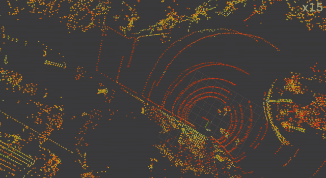
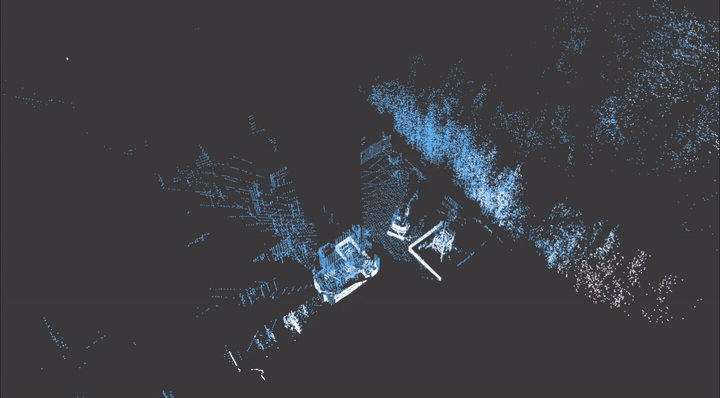
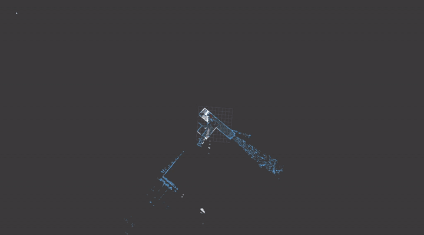

# Sapphire

基于 Gal(3) 等变 IMU 预积分的 LiDAR-惯性里程计。

[English](README.md)

Sapphire 从 LiDAR 与 IMU 估计 6-DoF 轨迹。逐点去畸变和 IMU 传播共用同一套
Gal(3) 运动模型，异步位姿图负责维持地图一致。核心库是独立的 C++17 实现，
ROS 1 与 ROS 2 只做封装。

## 演示

**S3E**



**HILTI 2022**



**HILTI 2023**



**Newer College 2020**


## 基准

下表是各次运行平移 ATE 的无权平均和中位数。ATE 为 SE(3) 对齐后的平移
RMSE，不做尺度修正，也不按轨迹长度加权。

| 数据集 | 进入均值的轨迹 | 覆盖范围的含义 | 平均 ATE | ATE 中位数 |
|---|---:|---|---:|---:|
| HILTI 2022 · like-for-like | 10 条完整轨迹 | 103 个已匹配控制点 | 0.197 m | 0.077 m |
| HILTI 2023 Site 1 手持 | 5 | 控制点折线共 346.4 m | 0.058 m | 0.052 m |
| S3E | 18 | 真值路径 11.39 km | 1.29 m | 1.11 m |
| Newer College 2020 | 5 | 真值路径 5.94 km | 0.2639 m | 0.1609 m |

HILTI 使用稀疏控制点，时间关联窗口为 2 s。S3E 与 Newer College 的窗口为
0.1 s。部分覆盖、未回放，以及未纳入均值的结果写在基准页里，不进上表。

HILTI 2022 主行沿用旧基线相同的 10 条序列，保证集合一致。当前重跑在
`exp10` 恢复完整覆盖后共有 11 条完整轨迹，但 `exp10` 的 1.956 m 误差使
全部完整汇总额为 0.357 m / 中位数 0.093 m；两种口径都记录在基准页。
[逐序列结果与轨迹图](docs/benchmarks/benchmark_table.zh.md)。

## 编译

```bash
git clone https://github.com/wagdeer/sapphire.git
cd sapphire
cmake -S . -B build -DBUILD_TESTING=ON
cmake --build build -j"$(nproc)"
cmake --build build --target test
```

依赖 CMake 3.16 或更新版本、C++17 编译器、Eigen 3.4、PCL 1.11 或更新版本、
OpenMP、GTSAM 4.3、small_gicp 和 spdlog。配置 PCL 时还需要一套 MPI C 库，
因为 VTK 的导入目标会引用 `MPI::MPI_C`。Sapphire 本身不调用 MPI。系统里已有
toml++ 3.4 时直接使用，否则由 CMake 下载这一版本。上面的 `test` 目标在
CMake 3.16 上可用；`ctest --test-dir` 需要 CMake 3.20。

## 安装

```bash
cmake --install build --prefix /opt/sapphire
```

下游工程把该前缀放进 `CMAKE_PREFIX_PATH`，用 `find_package(sapphire REQUIRED)`
找到静态库，并链接 `sapphire` 目标。消费方自己还要有 Eigen、PCL、GTSAM、
OpenMP、small_gicp、spdlog、toml++ 3.4 和一套 MPI C 库；这个安装包不带这些
依赖。编译 Sapphire 时由 CMake 下载的 toml++ 不会装进去。下面的 ROS 封装走
同级源码和 `add_subdirectory`，不需要这个前缀。

## ROS

ROS 1 与 ROS 2 是独立的封装包。把核心和要用的封装放在同一工作空间：

```text
ws/src/
├── sapphire/
└── sapphire_ros2/    或 sapphire_ros1/
```

ROS 2 Humble，在工作空间根目录执行：

```bash
source /opt/ros/humble/setup.bash
colcon build --symlink-install --packages-select sapphire_ros2
source install/setup.bash

ros2 launch sapphire_ros2 sapphire.launch.py \
  config_file:=/absolute/path/to/sapphire/cfg/sapphire_mid360.toml \
  lidar_topic:=/your_lidar \
  imu_topic:=/your_imu
```

`config_file` 必填。不改话题参数时，launch 订阅 `/front_lidar` 和
`/front_lidar/imu`。节点始终发布 `/sapphire/odometry` 和
`/sapphire/deskewed`。只有配置里 `pgo.enabled` 为 true 时，才发布
`/sapphire/trajectory`、`/sapphire/pgo/map` 和 `/sapphire/pgo/graph`。

依赖安装、Docker 和数据包回放见
[`sapphire_ros2`](https://github.com/wagdeer/sapphire_ros2) 与
[`sapphire_ros1`](https://github.com/wagdeer/sapphire_ros1)。数据集配置在
`cfg/`。回放步骤见 [docs/DATASET_REPLAY.md](docs/DATASET_REPLAY.md)。

## 文档

| 文档 | 内容 |
|---|---|
| [docs/benchmarks/benchmark_table.zh.md](docs/benchmarks/benchmark_table.zh.md) | 逐条 ATE，含未进入上表的结果 |
| [docs/DATASET_REPLAY.md](docs/DATASET_REPLAY.md) | 如何回放数据包并写出 TUM 轨迹 |

## 致谢

- [DLIO](https://github.com/vectr-ucla/direct_lidar_inertial_odometry)：管线与子图设计
- [Equivariant IMU Preintegration with Biases](https://github.com/aau-cns/equivariant-preintegration)：Gal(3) 预积分
- [small_gicp](https://github.com/koide3/small_gicp)：GICP 与 VGICP
- [GTSAM](https://github.com/borglab/gtsam)：增量位姿图优化

## License

MIT.
